<div align="center">


# AirPulse

**A modern, offline-first control panel for ZTE F50 and U30 Air 5G pocket Wi-Fi.**

Live speed and signal, band and cell lock, Wi-Fi and connected devices, SMS forwarding, an AT console and more.
It runs on the hotspot itself at `http://192.168.0.1:2333`.

[](https://github.com/kittors/AirPulse/actions/workflows/android-build.yml)
[](LICENCE)


[Features](#features) · [Screenshots](#screenshots) · [Install](#install-on-the-device) · [Build](#build-from-source) · [Develop](#frontend-development) · [Credits](#credits)

</div>

<br />

<picture>
  <source media="(prefers-color-scheme: dark)" srcset="docs/screenshots/overview-dark.png" />
  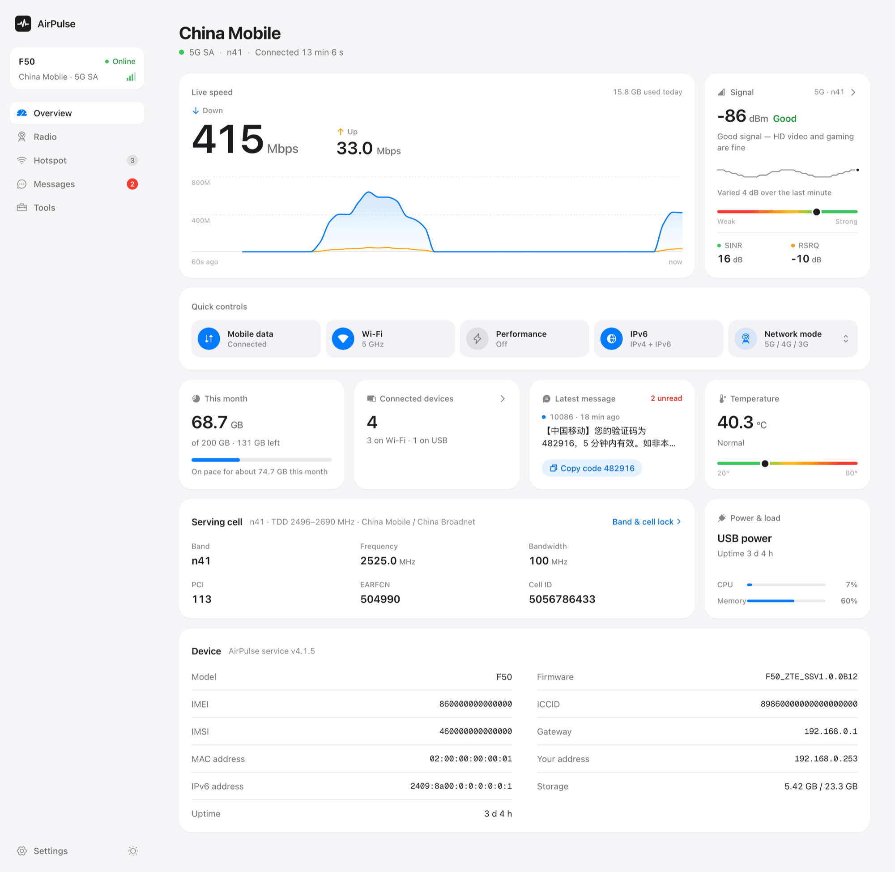
</picture>

<p align="center"><sub>All screenshots come from the built-in mock device, so the numbers, messages and identifiers are made up.</sub></p>

## Why AirPulse

The F50 and U30 Air are capable 5G hotspots, but the stock web page hides most of what the modem can do.
The community project [UFI-TOOLS](https://github.com/kanoqwq/UFI-TOOLS) unlocked those features with an on-device service.
Over time its web page grew dense and hard to read.

AirPulse keeps the UFI-TOOLS service and replaces its entire web console with a new app, rebuilt from scratch.
It starts from one question: *how is my connection right now, and what can I do about it?*

- **Numbers come first.** Speed, RSRP, SINR, RSRQ, band, PCI and EARFCN use large tabular figures that don't jump as they update. Each signal reading gets a plain-language rating.
- **Controls sit next to what they change.** Lock a band on the Radio page, lock a cell from the nearby-cells list, and flip Wi-Fi, IPv6 or performance mode from the overview.
- **Nothing happens by surprise.** Anything that can cut your connection asks first and explains what will happen. Switches wait until the device has applied the change before they settle.
- **It works without internet.** Fonts, icons and scripts are bundled into the APK, so the panel opens even when the SIM has no service. That is exactly when you need to change the network mode or unlock a band.
- **It suits any screen.** Laptops get a multi-column dashboard, phones get one column with a tab bar, and both have light and dark themes.

## Features

<table>
<tr>
<td width="50%" valign="top">

### Overview
- Carrier, network type (5G SA, 5G NSA or LTE) and connection time
- Live download and upload speed with a 60-second chart
- RSRP with a quality rating and 1-minute trend, plus SINR and RSRQ
- **Quick controls**: mobile data, Wi-Fi, performance mode, IPv6 and network mode, one tap each
- Monthly data usage against your plan, connected devices, temperature, power, CPU and memory
- Latest SMS, with one-tap copy for verification codes
- Serving cell (band, frequency, bandwidth, PCI, EARFCN, cell ID) and device details

</td>
<td width="50%" valign="top">

### Radio
- Network mode: 5G/4G/3G automatic, 5G NSA, 5G SA only, 4G/3G, 4G only or 3G only. Modes that can leave you without service warn first.
- **Band lock** with 5G NR and LTE band chips grouped by low, mid and high band
- **Nearby cells** with signal bars, RSRQ and SINR. Tap a row to lock that cell (PCI + EARFCN), lock one by hand, or remove all cell locks.

</td>
</tr>
<tr>
<td valign="top">

### Hotspot
- Wi-Fi on and off, and switching between 2.4 GHz and 5 GHz
- Network name, security, password, hidden network and device limit
- A QR code for joining from a phone
- Turning Wi-Fi off when idle
- Connected devices with type icons and Wi-Fi or USB link. Rename, block and unblock them.

</td>
<td valign="top">

### Messages
- Conversation-style inbox with search, compose and delete
- **SMS forwarding** to Email (SMTP), DingTalk, Bark, Telegram, WeCom, Feishu/Lark, PushPlus, ServerChan, ntfy, Gotify, any webhook or your own curl command
- Sender and keyword filters, test messages, and power and data-cap alerts

</td>
</tr>
<tr>
<td valign="top">

### Tools
- **AT console** with common queries, decoded QoS (QCI and subscribed rates), history, a SIM picker and guards for risky commands
- Embedded root web terminal (ttyd)
- Speed tests: LAN throughput (uses no cellular data), cellular download with a choice of servers, and iperf3 commands
- Scheduled tasks
- Advanced features: root access, USB or wireless ADB, SMB file sharing, port protection, boot script, custom code, boot-partition backup and file uploads
- **Update** AirPulse by uploading a new APK from the browser

</td>
<td valign="top">

### Settings
- **Network**: mobile data, roaming, **IPv6 on/off**, VoLTE, VoNR, high-speed rail mode, USB networking mode (RNDIS / CDC-ECM), SIM slot and APN profiles
- **Data**: usage history, data plan and alert level, usage calibration, and a data guard that cuts mobile data at a cap
- **LAN**: gateway address and DHCP range
- **Device**: name, status light, **performance mode**, scheduled restart, admin password, restart or shut down, and blocking system updates (FOTA)
- **General**: theme (light, dark or system), five accent colors, language (English or 简体中文) and access token

</td>
</tr>
</table>

> [!NOTE]
> **How the IPv6 switch works.** ZTE's firmware has no IPv6 switch. IPv6 follows the IP type of the active APN.
> AirPulse handles this for you. It sets the APN to *IPv4* or *IPv4v6*. If the APN is chosen automatically, AirPulse first creates a manual IPv4 copy of the carrier's profile. It then waits for the redial and shows whether the carrier actually assigned an IPv6 address.

## Screenshots

<table>
<tr>
<td width="50%">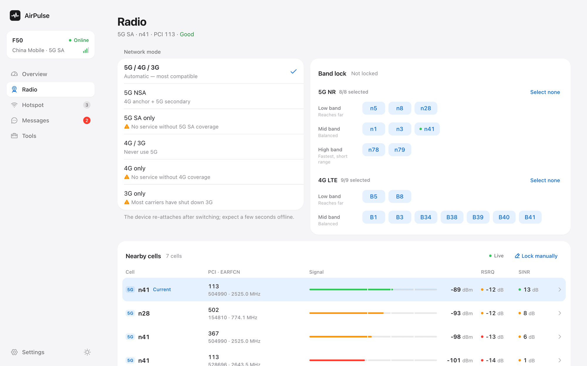<p align="center"><sub><b>Radio</b>: network mode, band lock and nearby cells</sub></p></td>
<td width="50%">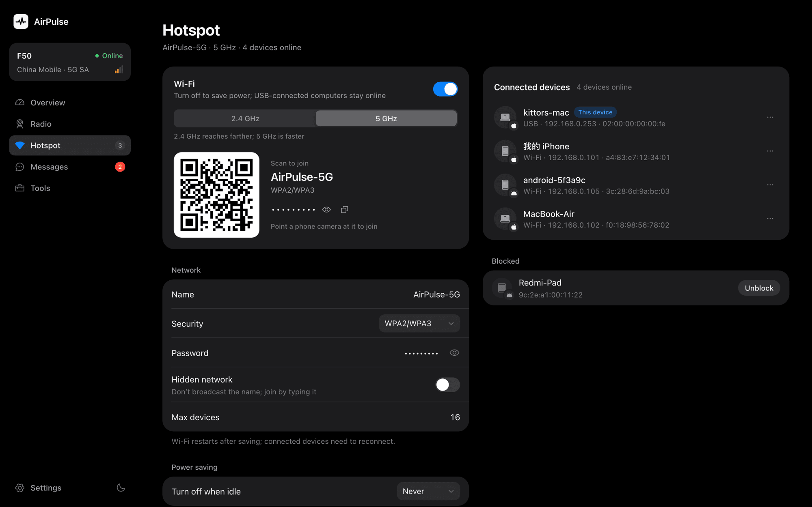<p align="center"><sub><b>Hotspot</b>: Wi-Fi, join QR code and connected devices</sub></p></td>
</tr>
<tr>
<td>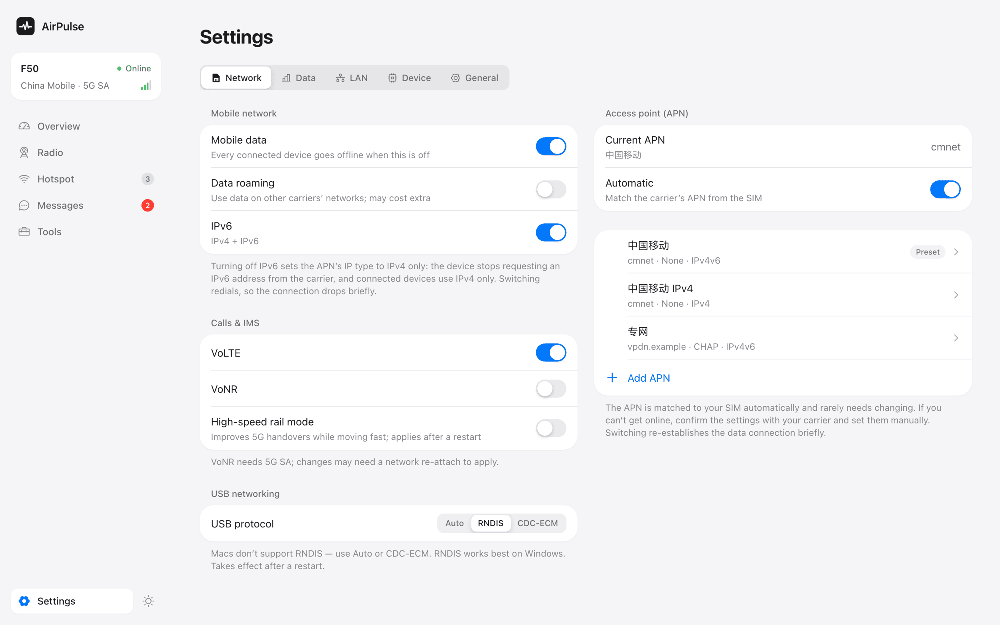<p align="center"><sub><b>Settings › Network</b>: data, IPv6, VoLTE/VoNR, USB mode and APNs</sub></p></td>
<td>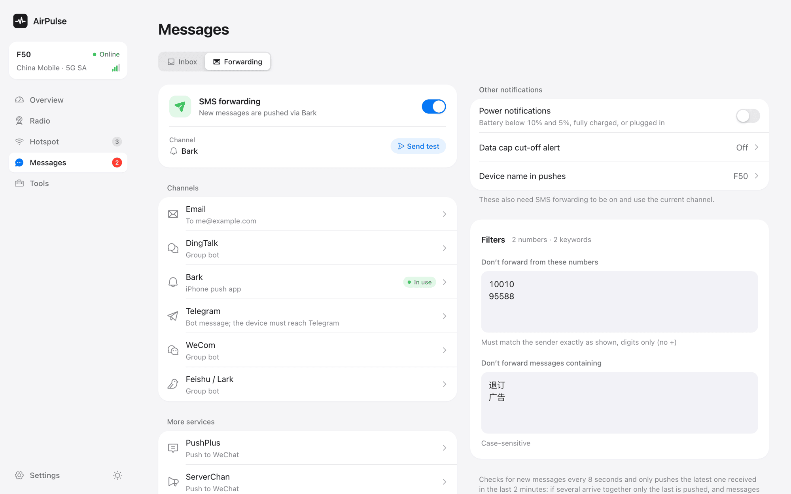<p align="center"><sub><b>Messages › Forwarding</b>: 12 channels, filters and alerts</sub></p></td>
</tr>
<tr>
<td>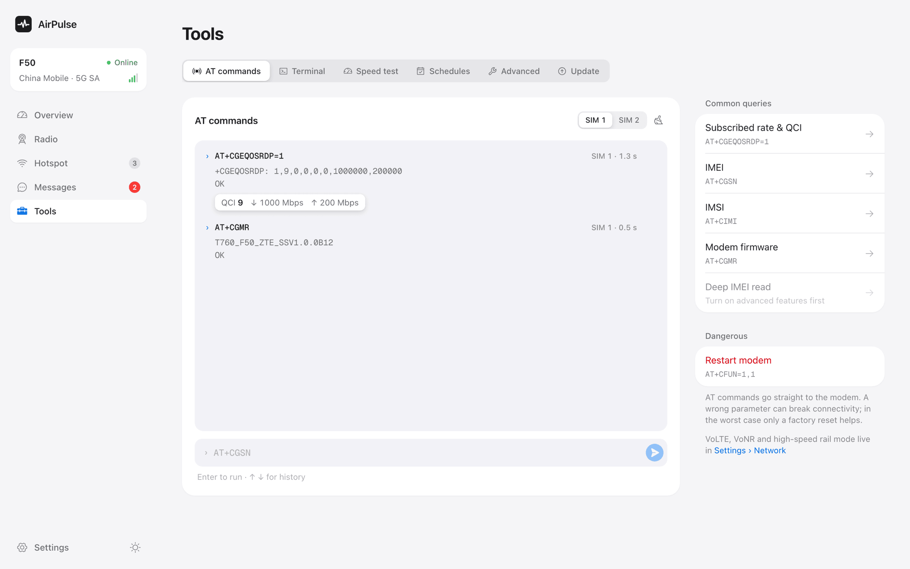<p align="center"><sub><b>Tools › AT commands</b>: presets, decoded results and history</sub></p></td>
<td>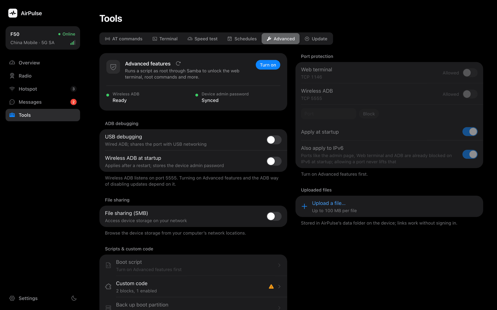<p align="center"><sub><b>Tools › Advanced</b>: root, ADB, SMB and port protection</sub></p></td>
</tr>
<tr>
<td>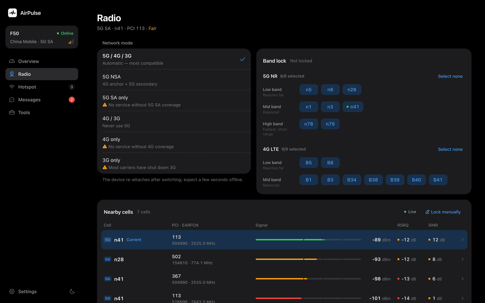<p align="center"><sub><b>Radio</b> in dark mode</sub></p></td>
<td>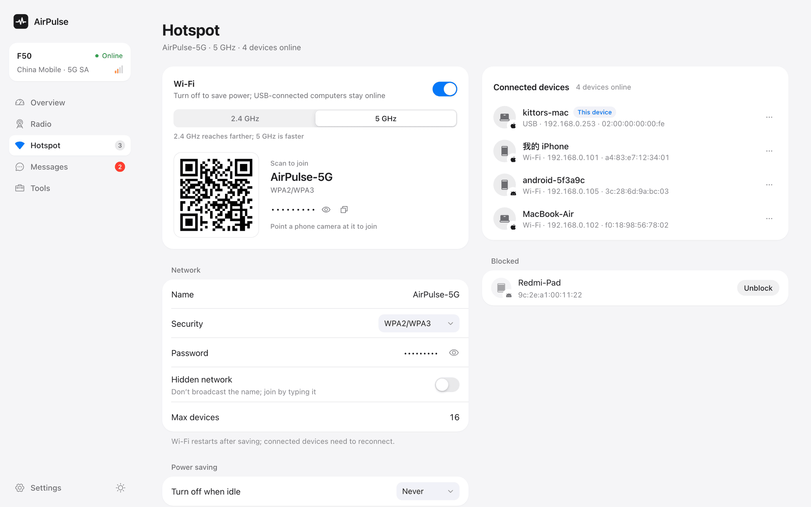<p align="center"><sub><b>Hotspot</b> in light mode</sub></p></td>
</tr>
</table>

### On a phone

<p align="center">
  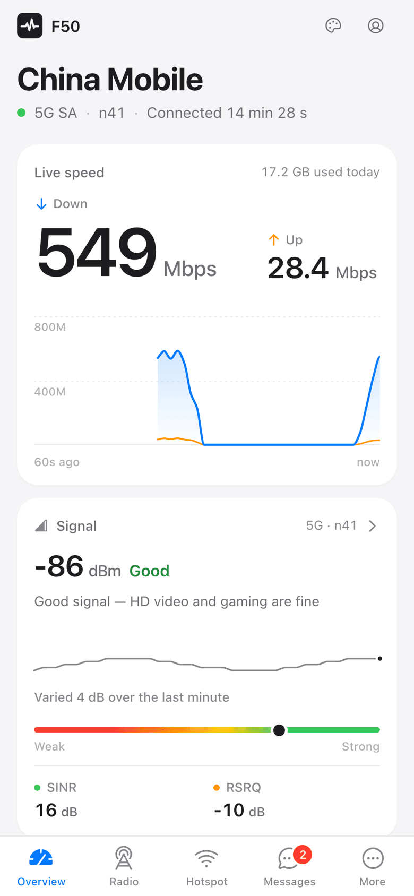
  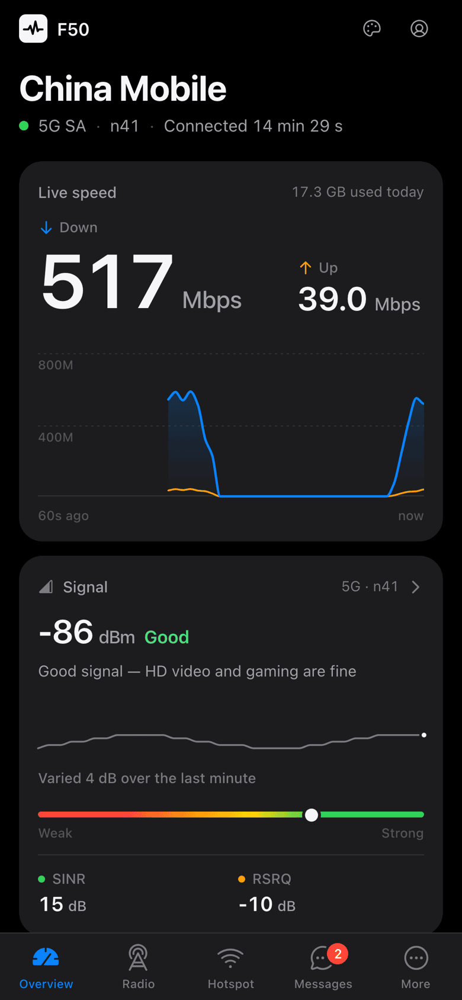
  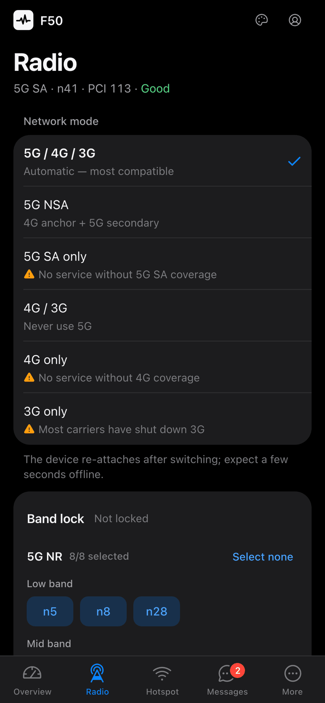
  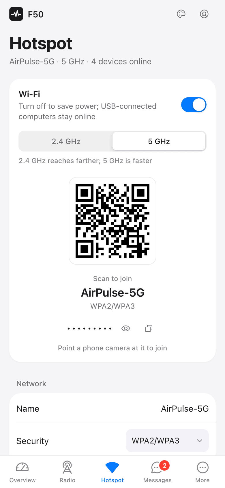
  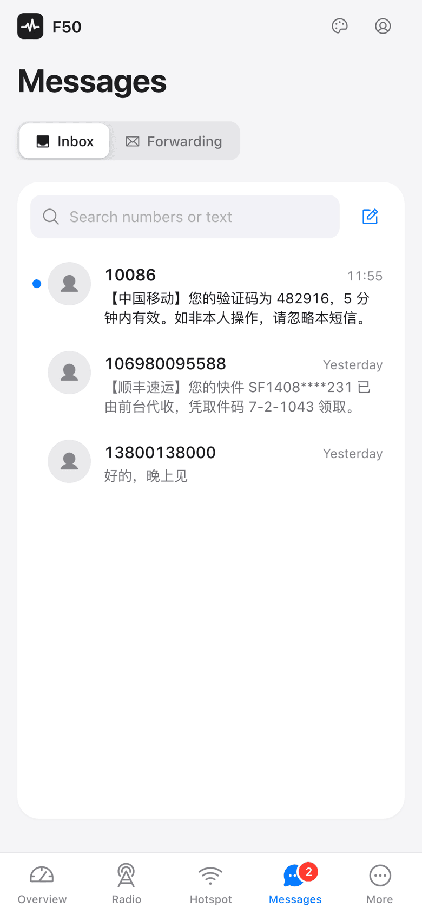
</p>

## Install on the device

AirPulse is a single Android APK. Its package name is `com.minikano.f50_sms`, the same as UFI-TOOLS. It runs a small web server on port **2333** and serves the AirPulse web app from its own assets.

**Supported devices:** ZTE F50 and U30 Air on Unisoc firmware. Other ZTE Unisoc devices that run UFI-TOOLS may also work.

### First install

1. Connect the hotspot to your computer and turn on ADB (USB debugging) on the device. How you do this depends on the firmware; the [UFI-TOOLS install guide](User_Doc.md#3-安装与首次使用) and its [video tutorial](https://www.bilibili.com/video/BV1qUHpzeEDd) (both in Chinese) cover the common cases.
2. Install the APK. Either [build it](#build-from-source) or download one from [Actions](https://github.com/kittors/AirPulse/actions/workflows/android-build.yml) (`app-debug.apk` under *Artifacts*):
   ```bash
   adb install -r app-debug.apk
   ```
3. Open the app once on the device (for example through [scrcpy](https://github.com/Genymobile/scrcpy)). Allow notifications and turn off battery optimization so the service keeps running.
4. Open **<http://192.168.0.1:2333>** in a browser and sign in:
   - **Token**: the AirPulse access token, `admin` by default. AirPulse reminds you to change it until you do.
   - **Password**: the device's own admin password, as used by `192.168.0.1:8080`. It is printed on the device label and is often `admin`.

<p align="center">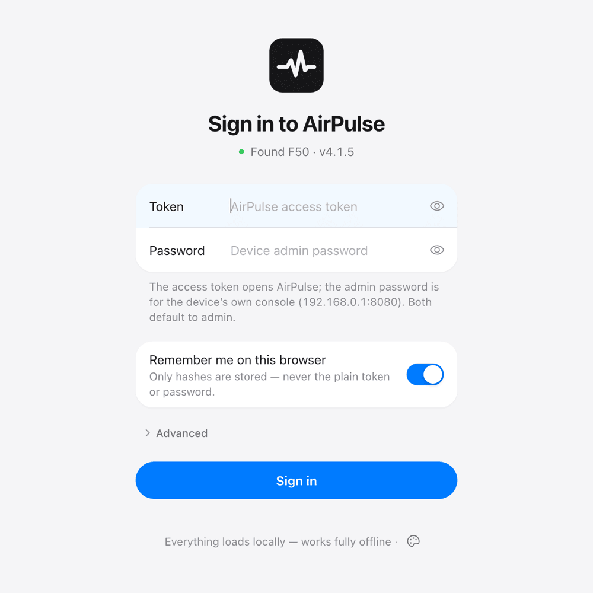</p>

### Updating

- **From AirPulse:** go to *Tools › Update* and upload the new APK. The service installs it and reconnects by itself.
- **From UFI-TOOLS:** AirPulse is a drop-in replacement because it is the same package. Android refuses an update signed with a different key, though. If your installed copy came from elsewhere, uninstall it first (`adb uninstall com.minikano.f50_sms`). This resets the service's own settings, such as the access token, forwarding rules and scheduled tasks.

## Build from source

**Requirements:** Node.js 20+, JDK 17 and the Android SDK (platform 35).

```bash
git clone https://github.com/kittors/AirPulse.git
cd AirPulse

# Web app: type-check, bundle, then sync into app/src/main/assets
cd app/frontEnd
npm ci
npm run build
cd ../..

# APK (also runs the web build above)
./gradlew assembleDebug
# → app/build/outputs/apk/debug/app-debug.apk
```

The web build writes to `app/frontEnd/dist/` first. `scripts/sync-assets.mjs` then copies it into `app/src/main/assets/`. The sync only replaces files it wrote last time; the backend's `shell/` and `certs/` directories next to them are never touched.

## Frontend development

```bash
cd app/frontEnd
npm install

npm run dev        # proxies /api to http://192.168.0.1:2333; falls back to the mock if no device is found
npm run dev:mock   # always use the built-in mock device
npm test           # Vitest unit tests
npm run typecheck  # tsc -b (strict)
```

- To use a device at another address, set `AIRPULSE_DEVICE=http://<ip>:2333 npm run dev`.
- **Mock device**: `mock/` simulates an F50 closely enough to develop every page offline. It includes live telemetry with bursty traffic, signal drift, nearby cells, SMS, forwarding channels, AT replies, the APN state machine, root and ADB tools, uploads and the update flow. It mirrors the real goform API's field names and quirks, so what works against the mock works on the device.
- **Non-secure context**: on the device the panel is served over plain HTTP. `crypto.subtle`, `crypto.randomUUID`, the async Clipboard API and Service Workers are therefore unavailable, and the code avoids them. Request signing uses [`@noble/hashes`](https://github.com/paulmillr/noble-hashes), and copying falls back to `execCommand`.

### Tech stack

| Area | Choice |
| --- | --- |
| UI | React 19, TypeScript (strict), Vite 6 |
| Styling | Tailwind CSS v4 with design tokens for light and dark themes |
| Components | Radix UI primitives (Dialog, Select, Switch, Tabs, Popover, Toast…) wrapped in custom components; no native `<select>`, checkboxes or browser dialogs |
| Data | TanStack Query: polling, optimistic updates, and waiting for the device to apply changes |
| Motion | Motion, plus View Transitions for page changes; respects *Reduce motion* |
| Icons and fonts | Phosphor Icons, Inter and Geist Mono, all bundled locally |
| Backend | The UFI-TOOLS Kotlin service (Ktor, on the device), unchanged |

### Project layout

```text
app/
├── frontEnd/                 # AirPulse web app
│   ├── src/
│   │   ├── api/              # typed clients for /api/* and the ZTE goform API
│   │   ├── model/            # pure parsing and planning logic (APN, telemetry, …)
│   │   ├── features/         # overview, radio, hotspot, messages, tools, settings
│   │   ├── components/       # UI kit (ui/) and visualizations (viz/)
│   │   └── i18n/             # English and Simplified Chinese
│   ├── mock/                 # mock device for development
│   ├── tests/                # Vitest
│   ├── docs/                 # design system and notes on the original API (Chinese)
│   └── scripts/sync-assets.mjs
└── src/main/                 # Android app: Ktor service, shell tools, assets
API_Doc.md                    # backend API reference (Chinese)
docs/screenshots/             # images used in this README
```

## Security notes

- **Change the default access token.** Anyone on your Wi-Fi or USB network can otherwise sign in.
- The panel is meant for your local network. Don't forward port 2333 (or the web-terminal port 1146 and ADB port 5555) to the internet. *Tools › Advanced › Port protection* can close the terminal and ADB ports when you don't need them.
- *Advanced features* give the service root access to the device. Only turn them on if you understand what that means.
- "Remember me" stores only hashes in the browser, never the plain token or password.

## Credits

AirPulse is built on **[UFI-TOOLS](https://github.com/kanoqwq/UFI-TOOLS)** by **[MiniKano](https://github.com/kanoqwq)**. That project provides the on-device service, the device integration and many of the features exposed here. Please consider starring and supporting the original project.

AirPulse also uses [React](https://react.dev), [Vite](https://vite.dev), [Tailwind CSS](https://tailwindcss.com), [Radix UI](https://www.radix-ui.com), [TanStack Query](https://tanstack.com/query), [Motion](https://motion.dev), [Phosphor Icons](https://phosphoricons.com), [Inter](https://rsms.me/inter/), [Geist Mono](https://vercel.com/font), [noble-hashes](https://github.com/paulmillr/noble-hashes) and [uqr](https://github.com/unjs/uqr).

## License

[MIT](LICENCE). Original UFI-TOOLS © 2025 MiniKano; AirPulse web console © 2026 kittors.

AirPulse is an independent community project. It is not affiliated with or endorsed by ZTE or any carrier. Changing radio settings can break connectivity or go against your carrier's terms, so use it at your own risk.
